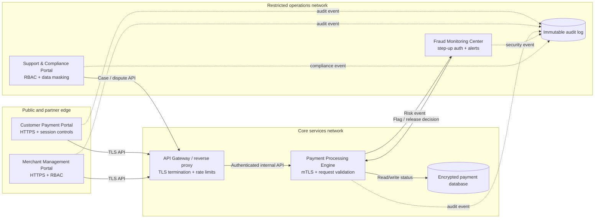
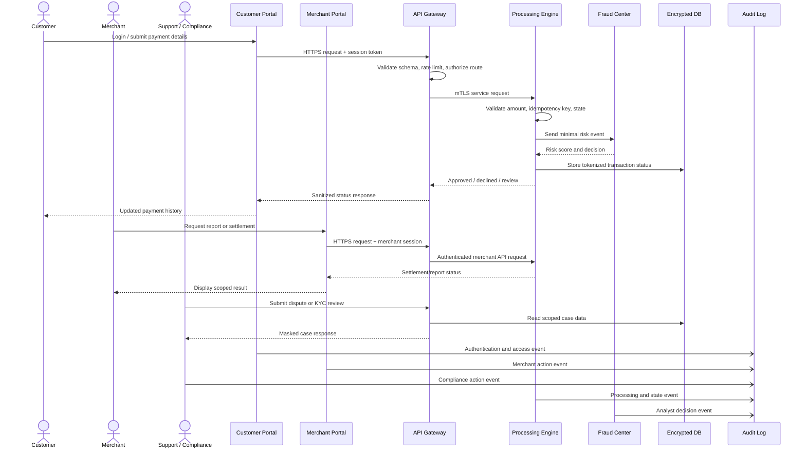
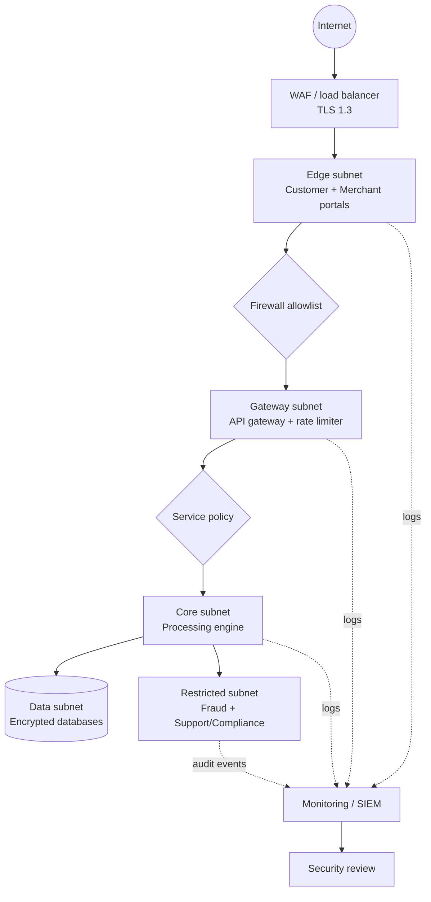

# Project 6: Secure Multi-Domain Payment Company Architecture

An architecture-focused college cybersecurity project. This repository contains a lightweight React prototype dashboard and the design documentation for a fictional payment company ecosystem.

> **Scope boundary:** This is not a real payment gateway. It contains no banking integration, real payment processor, OAuth provider, production secrets, or production deployment configuration. Payment activity shown in the dashboard is conceptual telemetry only.

## Problem Statement

A payment company needs multiple business applications that handle different users, data, and operational responsibilities. Without explicit trust boundaries, authentication rules, authorization policies, secure communication, and auditability, a weakness in one domain could expose the wider ecosystem.

## Objective

Design and communicate a secure multi-domain payment company architecture with five separate applications. The prototype demonstrates how each domain has a distinct business purpose, a defined trust zone, and layered security controls without implementing a real payment gateway.

## Features

- Five separately navigable application domains.
- Selected-domain security posture with trust zone, users, and enforced controls.
- Security telemetry summary for TLS termination, API authentication, and audit events.
- Responsive layout for desktop and mobile review.
- Prototype-only scope with no real payment processing.

## Installation

```bash
npm install
```

## Execution Steps

```bash
npm run dev
```

Open the local Vite URL. The left navigation and domain directory switch between all five application domains and update the selected security profile.

## How It Works

The React dashboard keeps the five domain definitions in one typed-by-convention data collection and uses a selected domain ID to render its purpose, trust zone, users, access posture, and controls. The navigation is intentionally local and demonstrative; it does not call a payment API or persist sensitive data.

## Business Purpose of Each Domain

| Domain | Business purpose | Primary users | Trust zone |
| --- | --- | --- | --- |
| Customer Payment Portal | Registration/login, transaction history, payment initiation, and customer-facing payment status. | Customers | DMZ / public edge |
| Merchant Management Portal | Merchant onboarding, received payment views, settlement requests, and reports. | Merchant operators | Partner zone |
| Payment Processing Engine | Payment validation, transaction routing, and lifecycle/status tracking. | Internal services | Core services |
| Fraud Monitoring Center | Suspicious transaction detection, risk scoring, analyst review, and alert management. | Fraud analysts | Restricted zone |
| Support & Compliance Portal | Support tickets, KYC tracking, compliance reviews, and dispute management. | Support and compliance staff | Restricted zone |

## Architecture Diagram



The gateway is the only public entry point. The processing engine is never directly reachable from an internet-facing network. Restricted operations applications have separate access policies and analyst/support roles.

## Data Flow Diagram



## Security Controls Table

| Control | Purpose | Protected component |
| --- | --- | --- |
| Authentication | Verify human and service identity using password hashing, login throttling, MFA, and mTLS. | All portals and processing APIs |
| Authorization | Enforce default-deny routes, least privilege, ownership checks, and scoped resource access. | Every domain and API endpoint |
| RBAC | Separate customer, merchant, processor, fraud, support, compliance, and administrator capabilities. | Merchant, fraud, and support workflows |
| Session security | Use Secure, HttpOnly, SameSite cookies, short idle timeouts, rotation, and revocation. | Customer and staff portals |
| Password hashing | Store no reversible passwords; use Argon2id or bcrypt with unique salts and strong work factors. | Human identity records |
| Encryption / TLS | Protect data in transit with TLS 1.3 externally and mTLS internally; encrypt data at rest. | Network paths and databases |
| API security | Apply gateway authentication, rate limits, replay protection, request IDs, and consistent errors. | Portal-to-core traffic |
| Input validation | Use allowlist schemas, type/length checks, canonicalization, output encoding, and idempotency keys. | Forms and APIs |
| Logging | Capture structured security, application, and access events with redaction. | All domains and gateway |
| Monitoring | Alert on authentication anomalies, failed validation, privilege changes, and unusual transaction patterns. | Control plane and SIEM |
| Audit trails | Preserve append-only actor, action, resource, timestamp, request, and result records. | Sensitive operations |
| Database security | Use encryption, separate service accounts, parameterized queries, masked fields, backups, and retention. | Payment, case, and audit stores |
| Network segmentation | Isolate public edge, partner, core, data, and restricted operations networks with allowlists. | Deployment topology |

## Security Considerations

This is a reference architecture, not a production implementation. The controls describe intended safeguards: identity verification, least-privilege authorization, secure sessions, TLS/mTLS, validation, encrypted stores, network boundaries, centralized monitoring, and append-only audit trails. A production system would require implementation evidence, security testing, key management, incident response, retention decisions, and compliance review.

## Technology Stack

- **Prototype UI:** React with Vite and plain CSS.
- **Fonts:** DM Sans, Space Grotesk, and DM Mono for a compact operations-console visual language.
- **Documentation:** Markdown and Mermaid diagrams.
- **Reference backend choices:** REST/JSON APIs, an API gateway/reverse proxy, PostgreSQL or equivalent encrypted relational storage, and centralized structured logging.
- **Security primitives:** Argon2id/bcrypt for password hashing, TLS 1.3, mTLS for internal calls, signed short-lived sessions, schema validation, and immutable audit storage.
- **Explicitly out of scope:** Kubernetes, Kafka, microservice infrastructure, third-party OAuth, live banking integrations, and production deployment automation.

## Deployment Diagram



## Threats and Mitigations

| Threat | Likely impact | Mitigation |
| --- | --- | --- |
| SQL injection | Data disclosure, corruption, or unauthorized database actions. | Parameterized queries, strict schema validation, least-privilege database accounts, and security testing. |
| Brute force / credential stuffing | Account takeover or denial of access. | Argon2id, MFA for privileged roles, rate limits, lockout/backoff, breached-password checks, and alerts. |
| Session hijacking | An attacker acts as an authenticated user. | Secure HttpOnly SameSite cookies, TLS, session rotation, short idle timeouts, revocation, and anomaly monitoring. |
| Unauthorized access / broken object authorization | A user views or changes another customer, merchant, or case record. | Server-side ownership checks, RBAC plus object permissions, deny-by-default tests, and audit alerts. |
| Data leakage | Sensitive payment, KYC, dispute, or fraud data is exposed. | Encryption, data masking, redaction, network segmentation, scoped APIs, and retention controls. |
| API injection or malformed requests | Data corruption, crashes, or unauthorized behavior. | Strict schemas, parameterized queries, output encoding, content limits, and normalized error handling. |
| Interception or service impersonation | Sensitive data disclosure or forged internal requests. | TLS 1.3 externally, mTLS internally, certificate rotation, and network allowlists. |
| Replay or duplicate payment request | Duplicate transaction state changes. | Idempotency keys, request timestamps/nonces, state-machine validation, and bounded replay windows. |
| Insider threat | Unauthorized access to KYC, dispute, or fraud data. | Least privilege, separation of duties, data masking, step-up authentication, and immutable audit trails. |
| Fraudulent or high-risk transaction | Financial loss or compliance exposure. | Risk scoring, velocity rules, manual review queue, alert management, and transaction holds. |
| Log tampering or sensitive logging | Forensic gaps or privacy incident. | Append-only audit sink, restricted log access, integrity monitoring, field redaction, and retention controls. |
| Database compromise | Exposure or manipulation of sensitive records. | Segmentation, encryption, separate credentials, backups, patching, query controls, and monitoring. |

## Prototype Notes

The dashboard is intentionally a visual architecture walkthrough rather than a functional payment application. It demonstrates:

1. Five distinct domains with separate business purposes.
2. Navigation between domains with changing trust-zone and control details.
3. A security posture overview with TLS, API authentication, and audit telemetry.
4. A clear prototype-only boundary so the UI is not mistaken for a live gateway.

## Future Improvements

- Add a small mock API with seeded, non-sensitive data and contract tests.
- Add a threat-model appendix using STRIDE and abuse-case diagrams.
- Add a formal identity service boundary with MFA enrollment and recovery flows.
- Add policy-as-code examples for gateway routes and database access.
- Add automated security testing: dependency scanning, SAST, DAST, and API fuzzing.
- Define retention, deletion, incident response, and disaster recovery runbooks.
- Map controls to a chosen framework such as NIST CSF, OWASP ASVS, or PCI DSS scope without claiming certification.

## Validation

```bash
npm run build
```

The current prototype builds successfully with Vite.
# payment-company

